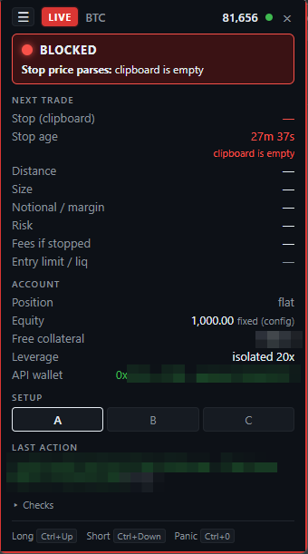
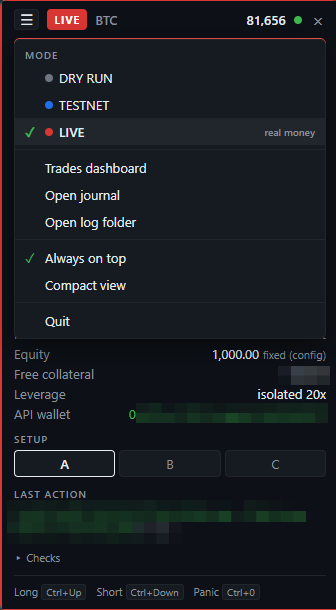
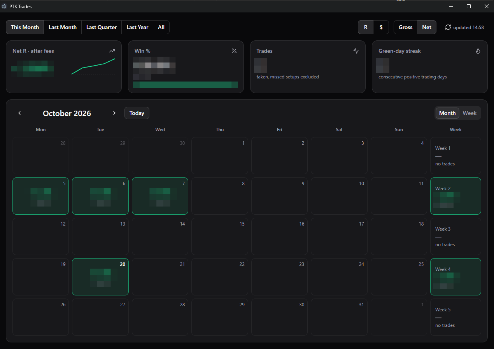

# PTK Terminal

A Windows desktop hotkey tool for scalping BTC perpetuals on [Hyperliquid](https://hyperliquid.xyz). Copy a stop price from the chart, press a hotkey, and it opens a position sized to a fixed % risk of equity, with a reduce-only stop attached on the exchange in the same signed action.

Built with Electron, React and Vite. All trading logic runs in the main process; the panel only displays state.

<p align="center">
  
  &nbsp;&nbsp;
  
</p>
<p align="center"><em>Left: the trade panel, blocked until a valid stop is on the clipboard. Right: the ☰ menu for switching modes and opening the journal, logs and dashboard.</em></p>



*The trades dashboard: results by day, week and month, in R or $, before or after fees (figures blurred).*

> **Use at your own risk.** This software places real orders with real money when run in live mode. It comes with no warranty. Test in dry run and on testnet first, and start live with a reduced `riskPct`.

## Features

- **Fixed-R sizing:** size = equity × `riskPct` ÷ stop distance, always rounded down to the lot size.
- **Stop always on the exchange:** entry (IOC) and stop-market go out as one action. If the stop is missing after the fill, the tool retries once, then flattens.
- **Validation gate:** ordered checks (connection, leverage, existing position/orders, clipboard freshness, stop side and distance, size, margin, liquidation buffer, slippage). The panel's ready light uses the same checks as the hotkey press.
- **Panic key:** cancels all BTC orders and flattens the position.
- **Three modes:** `dryRun` (mainnet data, no key, nothing sent), `testnet` and `live`. Live starts disarmed and must be armed for the session.
- **Trade journal:** one CSV row per trade with net R, fees, slippage and MAE/MFE.
- **Optional Notion sync:** mirrors each mainnet trade into a Notion database, plus a calendar dashboard of results in R or $.
- **Activity log:** daily log files with anything shaped like a private key redacted.

## Requirements

- Windows (global hotkeys and clipboard flow are built for it)
- Node.js ≥ 22.12
- A Hyperliquid account, and for testnet/live an **API (agent) wallet** approved for that network. Never use your main wallet's private key.

## Setup

```
npm run setup   # install dependencies (scripts disabled) and download Electron
npm start       # build the panel and run the app
npm run dev     # Vite dev server + Electron with hot reload
npm test        # run the tests
```

1. Copy `config.example.json` to `config.json` and set `accountAddress` to your main wallet's **public** address. Leave `mode` as `dryRun` to start.
2. For testnet or live, copy `.env.example` to `.env` and fill in your API wallet key(s). The Notion values are optional and only needed for the Notion sync and dashboard.

3. Set leverage to **isolated** at `config.leverage` (default 20x) manually in the Hyperliquid UI. The tool verifies leverage but never sets it.
4. Settings are read at startup, so restart after any change.

`config.json`, `.env`, `trades.csv`, `logs/` and the other runtime files are gitignored. Never commit them.

## Usage

1. Right-click the stop level on the Hyperliquid chart and copy the price.
2. Press the long or short hotkey (defaults: `Ctrl+Shift+Up` / `Ctrl+Shift+Down`; panic is `Ctrl+Shift+X`).
3. The panel shows the result. Exits are manual in the Hyperliquid UI, or via the panic key.

Switch modes from the ☰ menu or by editing `mode` in `config.json`.

## Documentation

- **[index.md](index.md):** architecture, module map, press lifecycle, validation gate, sizing maths, failure handling, verified Hyperliquid behaviour and gotchas. Start here.
- [`Hyperliquid 1m Scalp Entry Tool — Build Spec.md`](<Hyperliquid 1m Scalp Entry Tool — Build Spec.md>): the original requirements.
- [`PLAN.md`](PLAN.md): build plan and design decisions.
- [`features/`](features): notes on built and proposed features (Notion sync, trades dashboard, multi-coin).

## Disclaimer

This is a personal tool shared as-is, not financial advice. Trading leveraged perpetuals can lose more than you expect, quickly. You are responsible for any orders it places.
